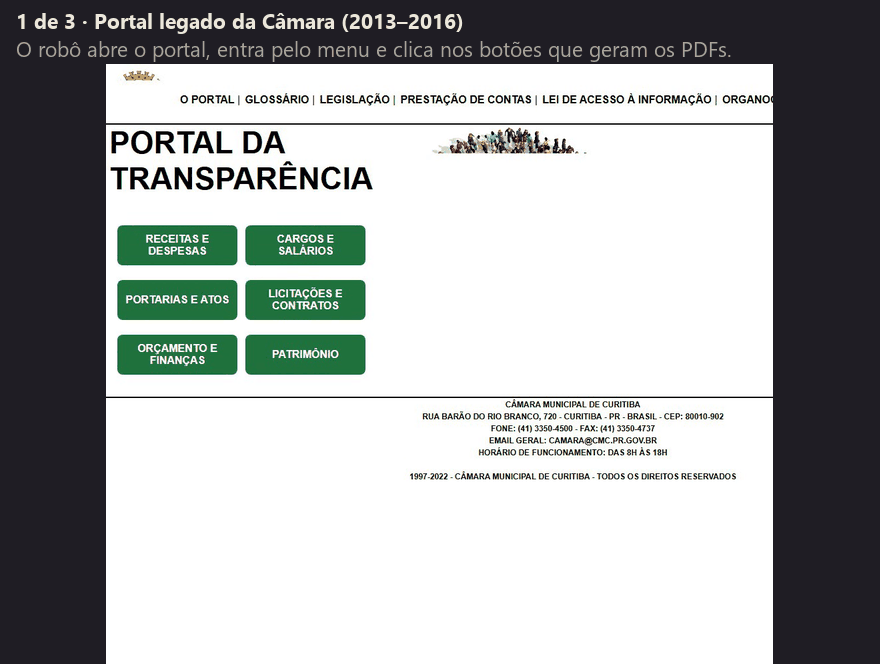

# rpa-transparencia

[](https://github.com/GustavoJannuzzi/rpa-transparencia/actions/workflows/ci.yml)
[](https://github.com/GustavoJannuzzi/rpa-transparencia/actions/workflows/contrato.yml)
[](LICENSE)

Cada casa legislativa publica os gastos num sistema diferente, e muitas casas usam o
mesmo fornecedor. Este projeto tem **um adaptador por sistema, configurado por
entidade**: o mesmo robô do Elotech serve 13 câmaras do Paraná, o do Betha serve
14, e casa nova num fornecedor que já tem adaptador é um bloco em
[`coleta/entidades.toml`](coleta/entidades.toml), sem código.

Começou pela Câmara Municipal de Curitiba, que trocou de sistema três vezes: o
histórico das diárias está em quatro lugares, de quatro fornecedores (um portal
antigo que só gera PDF, o Elotech, o portal da Prefeitura e o Betha). Hoje junta,
num modelo único, a cota dos deputados federais, as verbas dos deputados do DF, de
MG e de SP e as diárias de 26 câmaras municipais do PR. Robô de navegador (Python +
Playwright) onde não há API; API e arquivo onde há. Cada número passa por
conferência contra o que a própria fonte diz de si, tem a procedência anotada, e o
que não fecha vai para uma fila de revisão em vez de ser chutado.

Uma plataforma estática (Next.js) mostra o resultado num grafo: deputados federais
e estaduais ligados por fornecedor em comum (o CNPJ é a mesma chave nas duas
esferas) e vereadores ligados aos seus partidos, com a ficha de procedência de cada
valor a um clique. A página [Cobertura](https://rpa-transparencia.vercel.app/cobertura/)
mostra quais casas estão coletadas, em qual sistema, e por que as outras ainda não
estão.



*O robô (Playwright) nos três sistemas que só se leem pelo navegador, gravado pela
própria coleta (`coletar --gravar-video`, 26/11/2026), em trechos escolhidos. As
tabelas que listam servidores aparecem borradas, e a página da Prefeitura está
recortada acima da grade: nome de servidor não é publicado, nem em imagem.*

## O que cada fonte exigiu

| Fonte | Anos | Como | O que tinha de difícil |
|---|---|---|---|
| Portal legado da Câmara de Curitiba | 2013–2016 | robô + PDF | Aplicação React em que subpágina não abre direto: o robô navega pelo menu, clica no botão e captura o download. O PDF é uma planilha exportada: leitura pela grade da tabela, layout que muda de 11 para 15 colunas no meio da série, quatro formatos de período, valores compostos ("02 diárias + 02 refeições"). |
| Elotech | 2017–2023 | API | O próprio portal publica a API, então não há navegador. De 2017 a 2020 a diária vem sem nome, só com a matrícula (em 2018, às vezes dentro do campo cargo: "Vereador/1083"); o nome sai do quadro de pessoal do mesmo ano. |
| Portal da Prefeitura | 2024–2025 | robô | ASP.NET WebForms: cada filtro e cada página da tabela é um postback. A paginação não é reproduzível (a ordem muda entre postbacks), então o robô consulta mês a mês, lê duas vezes o mês que pagina, confere que toda linha é do órgão filtrado e compara com a consulta do ano inteiro. |
| Betha | 2026 | robô | Aplicação Vue. O robô lê a tabela da tela e confere cada linha com a resposta que a própria tela recebeu. Devolve 403 para User-Agent com "HeadlessChrome". |
| Câmara dos Deputados | 2023–2026 | API + arquivo | API para a lista de deputados e para conferência por amostra; arquivo anual para a carga. |
| Elotech em mais 12 câmaras do PR | 2023–2026 | API, o mesmo adaptador de Curitiba | A instalação atende Prefeitura, Câmara e autarquias; o robô confere a entidade da Câmara pelo CNPJ antes de coletar. Diária sem cargo (quase metade em algumas câmaras): o nome só fica se estiver, igual, no cadastro de vereadores do mesmo ano; senão é descartado na leitura e a linha vai para revisão. Exercício que a lista mostra e a contabilidade não tem (Renascença, 2023); instalação própria em que a API omite o campo do cargo (Umuarama). |
| Câmara Legislativa do DF | 2023–2026 | arquivo (CKAN) | 2024 e 2025 completos só em planilha XLSX, lida sem biblioteca. Cabeçalho, data e valor mudam a cada ano; a planilha de 2025 mistura dia/mês e mês/dia (a data só é lida quando é inequívoca) e tem linhas com as colunas deslocadas; o CNPJ gravado como número perde os zeros à esquerda (recompostos só quando os dígitos verificadores fecham). O CPF do deputado liga as grafias do nome na memória e não é gravado. |
| Assembleia de Minas Gerais | 2023–2026 | API | Uma chamada por deputado e mês, só nos meses que a API diz ter prestação fechada. A soma das notas de cada tipo é conferida contra o total que a própria API dá para o tipo no mês. |
| Assembleia de São Paulo | 2023–2026 | arquivo (JSON de 160 MB) | O arquivo traz 2002–2026 de uma vez: baixa só quando a data dele muda, guarda comprimido (20 MB) e lê em fluxo. A fonte publica a despesa já somada por fornecedor × tipo × mês: cada linha é um agregado, e a plataforma diz isso. |
| Betha em mais 13 câmaras do PR | 2014–2026 (o que cada câmara publica) | robô, o mesmo adaptador de Curitiba | Cada câmara monta o próprio menu, e a mesma consulta aparece com outro número, em outro grupo e com outro texto ("Diárias", "Diárias.", "DIÁRIAS"). O robô acha a consulta pelo texto do item na tela e tira o número do menu que a página recebe; quando dois itens têm o mesmo texto (Bandeirantes), fica o que tem as colunas de diária. "0 registros" é resultado: a câmara tem a consulta e não a alimenta (Almirante Tamandaré). A consulta de Cornélio Procópio traz cargos da Prefeitura: as diárias de servidor dela vão para revisão. |
| TSE | eleições 2012–2024 | arquivo | Partido de cada vereador na eleição do mandato, nos 26 municípios (nenhum sistema das câmaras traz partido). |

O levantamento que decidiu cada uma dessas escolhas, feito antes de escrever o
código, está em [`docs/etapa-0.md`](docs/etapa-0.md).

### O que ficou de fora, e por quê

O levantamento de 26/11/2026 procurou o fornecedor do portal das 399 câmaras do PR
e as despesas das 27 assembleias. O que ficou de fora:

| Casa ou fornecedor | Por quê |
|---|---|
| Assembleia do Paraná | A consulta da verba pede captcha, e o robots.txt proíbe a API. Captcha nunca se contorna. |
| IPM Atende.net (28 câmaras, entre elas Cascavel, Colombo e Guarapuava) | O robots.txt proíbe a consulta, e ela passa por um desafio da Cloudflare. |
| Inga Digital (32 câmaras) | O robots.txt proíbe o portal inteiro. |
| 39 câmaras, entre elas Londrina | O robots.txt do site proíbe qualquer robô. |
| Equiplano (36 câmaras) e Govbr Pronim (14) | Próximos adaptadores, pelo navegador. |
| União da Vitória, Goioerê, Jaguariaíva e Mandirituba (Betha) | O portal não tem a consulta de diárias com o cargo de quem recebeu: só a de empenhos de viagem, que mistura passagem e diária e não diz o cargo. |
| As outras câmaras Betha (o levantamento contou 59) | O adaptador já serve: falta pôr a câmara na configuração. |
| As outras câmaras Elotech (o levantamento contou 108) | O adaptador já serve: falta pôr a câmara na configuração. |
| Assembleias do AP, CE, TO, BA, GO, PE e RN | Fonte com fornecedor e CNPJ, mas só pela tela: próxima leva, pelo navegador. |
| Assembleias de MS, AM, RO, PB, AL, RS e SC | Na reserva: fonte aberta, ainda sem adaptador (em PB o CNPJ vem mascarado; em AL é PDF escaneado). |
| Assembleias do ES, PA, RR, SE e AC | Só totais, sem dizer quem recebeu, ou nada por deputado. A do RJ não tem verba indenizatória. |
| Assembleia do PI | Proteção contra robô no portal. MT estava fora do ar, e a do MA voltou vazia (não verificadas). |
| 135 câmaras | O levantamento não identificou o fornecedor do portal. |

A página [Cobertura](https://rpa-transparencia.vercel.app/cobertura/) traz essa
tabela casa por casa, com o mapa do PR por município e o do Brasil por UF.

## O resultado da última rodada (coleta de 25 e 26/11/2026)

O [relatório de conferência](relatorio/conferencia.html) é gerado a cada rodada. Para
cada fonte, **origem = coletado + revisão**, e nenhum item com erro em aberto:

| Fonte | Linhas na origem | Coletadas | Em revisão |
|---|---:|---:|---:|
| Câmara dos Deputados (arquivos anuais, 57ª legislatura) | 790.635 | 659.576 | 131.059 |
| Legado de Curitiba (PDFs) | 193 | 180 | 13 |
| Elotech (Curitiba) | 117 | 114 | 3 |
| Portal da Prefeitura | 121 | 40 | 81 |
| Betha | 54 | 54 | 0 |
| Elotech, 12 câmaras do PR | 2.671 | 2.374 | 297 |
| Betha, 13 câmaras do PR | 2.729 | 1.785 | 944 |
| Câmara Legislativa do DF | 3.183 | 2.614 | 569 |
| Assembleia de Minas Gerais (notas) | 94.209 | 94.209 | 0 |
| Assembleia de São Paulo (linhas agregadas) | 82.182 | 82.182 | 0 |

São 30 casas, com 1.371 parlamentares na plataforma. Nas câmaras do Elotech, a
maior parte do que está em revisão é diária sem cargo cujo nome não está no cadastro
de vereadores do ano: pode ser de servidor, então o nome é descartado e a linha fica
de fora, contada. No Betha, 877 das 944 linhas em revisão são de Cornélio Procópio,
cuja consulta da Câmara traz diárias de cargos da Prefeitura (achado abaixo).

"Coletadas" inclui as linhas que a própria fonte marca como canceladas ou devolvidas
(publicadas, mas fora da soma) e as de 2026 da Prefeitura, que servem para conferir
o Betha na fronteira entre os dois sistemas. As 81 da Prefeitura em revisão são 2024
e 2025 inteiros (ver o achado abaixo).

## O que a conferência achou

Achados reais, todos visíveis no relatório e na fila de revisão:

- **A consulta da Câmara com diárias da Prefeitura.** No Betha de Cornélio Procópio,
  a consulta "Diárias." da Câmara traz cargos como "Chefe de Gabinete do Prefeito",
  "Secretário Mun. Agric., Pec. e Meio Ambiente" e "Chefe de Divisão de Galerias de
  Águas Pluviais", de 2014 a 2026, e o filtro de entidade da própria consulta diz
  que tudo é da Câmara. Sem como separar as duas entidades, as diárias de servidor
  dessa consulta ficam em revisão; as de vereador seguem publicadas.
- **Dois itens de menu com o mesmo texto.** O Betha de Bandeirantes tem "Diárias" e
  "DIÁRIAS" no mesmo grupo do menu, com consultas diferentes. O robô abre as duas e
  fica com a que tem as colunas de diária por pessoa; a outra é registrada como
  descartada, com as colunas que tinha.
- **Um portal sem total e com paginação que muda.** No portal da Prefeitura, duas
  leituras da mesma consulta trouxeram conjuntos diferentes de linhas. O robô passou
  a ler cada ano por dois caminhos independentes (mês a mês e ano inteiro). Em 2026
  os dois deram o mesmo conjunto; em 2024 e 2025 não, e sem total publicado não há
  como desempatar: esses anos ficam inteiros em revisão, com o motivo, em vez de
  aparecer na plataforma com um número que pode estar incompleto.
- **O total do mês do PDF só fecha sem a linha devolvida.** Abril de 2016 soma R$ 340,00
  nas linhas e o PDF diz R$ 140,00; a diferença é uma diária marcada "Devolvido". A
  conferência tenta a soma com e sem as linhas marcadas e só aceita a que bate com a
  fonte.
- **Linhas em que quantidade × unitário não dá o total** (por exemplo, 1 diária de
  R$ 290 + 1 refeição de R$ 200 com total de R$ 390) vão para revisão, mesmo quando o
  total do mês confere.
- **O arquivo anual da Câmara arredonda alguns valores**: R$ 39.800,25 na API aparece
  como 39800.3 no CSV e no JSON anuais. Na amostra, o arquivo também traz menos
  passagens aéreas do SIGEPA que a API em 2024–2026. Essas categorias e anos ficam em
  revisão, fora dos totais.
- **A API devolve o valor líquido com o sinal trocado** em 3.060 das 4.925 linhas da
  amostra (`valorLiquido = −valorDocumento`); a conferência compara pelo valor do
  documento, e é por ele que se vê onde arquivo e API batem centavo a centavo.
- **Valor negativo com documento maior que zero** (complementação do auxílio-moradia) não
  tem explicação na fonte e vai para revisão; passagem com valor e documento negativos
  é compensação de bilhete e entra.
- **A matrícula do vereador muda de um mandato para outro**: a identidade é montada
  ligando matrículas, nomes civis e o nome de urna do TSE, não pela matrícula sozinha.
- **Um erro de digitação da fonte ("Veradora")** passa pela guarda de privacidade como
  servidora (o nome é descartado na leitura) e cai na revisão porque a tabela de-para
  sabe que é vereadora. Nas câmaras novas, sem tabela revisada à mão, cargo que se
  parece com o de vereador sem ser ("Veriador", "Presidente Legislativo") também vai
  para revisão, em vez de virar servidor.
- **A CLDF publica dois arquivos para o mesmo ano, e eles não batem.** Em 2023, 90 das
  1.474 notas da planilha XLSX não estão no CSV do mesmo ano, e as notas do CSV que
  faltam na planilha ficam em revisão. O arquivo "2024 (até maio)" deveria estar contido no de 2024 inteiro, e 5
  das 92 notas dele não estão.
- **Na planilha de 2025 da CLDF**, a mesma coluna traz "1/16/2025" (mês primeiro) e
  "21/03/2025" (dia primeiro). A data que pode ser lida dos dois jeitos não é chutada.
- **A soma das notas da ALMG fecha** com o total que a própria API dá para cada tipo de
  despesa, em todos os meses coletados.

## Como rodar

Python 3.11+ e Node 22.

```bash
python -m venv .venv
.venv/Scripts/python -m pip install -r requirements.txt     # no Linux/macOS: .venv/bin/python
.venv/Scripts/python -m playwright install chromium
```

```bash
.venv/Scripts/python -m coleta tudo
```

`tudo` roda, em sequência: `descobrir` (inventário de cada fonte e os totais que ela
mostra), `coletar` (percorre o inventário; rodar de novo só pega o que falta),
`conferir`, `publicar` (os JSON da plataforma, só com o que passou) e `relatorio`.
Cada comando também roda sozinho, e `--fonte` limita a uma fonte ou a um fornecedor
inteiro (`--fonte elotech`, `--fonte assembleia`). `coletar --gravar-video` grava o
navegador em `dados/evidencias/videos/`.

A primeira rodada completa baixa ~430 MB de arquivos do TSE e da Câmara dos Deputados
e o arquivo da ALESP (160 MB, guardado comprimido) para `dados/cache/`. A coleta é
educada: uma requisição por vez em cada portal, com a pausa que o robots.txt de cada
domínio pede (Crawl-delay, 10 s nos dados abertos da CLDF e da ALESP) e um piso
próprio. A da ALMG faz uma chamada por deputado e mês e leva perto de uma hora.

Plataforma:

```bash
cd plataforma
npm ci
npm run build
npm test
```

`npm run build` gera o site estático em `plataforma/out/`; `npm test` confere que todo
valor em reais nas páginas tem procedência.

## Testes

```bash
.venv/Scripts/python -m pytest
```

- **Parser:** PDFs, páginas, planilhas e respostas reais, gravados pelo robô em 25 e
  26/11/2026, em [`coleta/testes/amostras/`](coleta/testes/amostras/) (com nome de
  servidor tarjado e CPF trocado por número que não fecha o dígito verificador).
- **Resiliência:** o Playwright serve o portal legado a partir das amostras, sem rede,
  e injeta erro 500, lentidão e queda de sessão; o resultado tem de ser igual ao da
  rodada limpa. O mesmo para a API do Elotech, com 503 e timeout, em Curitiba e no
  adaptador genérico (Maringá).
- **Retomada:** a coleta é interrompida no meio, retomada, e não duplica nada.
- **Conferência:** casos montados (total que não fecha, categoria sem de-para, mesmo
  registro em dois sistemas na fronteira, cargo fora da guarda de privacidade).
- **Contrato:** um teste por fonte contra o portal de verdade, separado dos outros,
  avisa quando o layout mudou: `python -m pytest -m contrato`.

## Integração contínua

Cada push roda, no GitHub Actions, o ruff, o mypy e o pytest; o build da plataforma,
o `tsc` e o teste de procedência; o axe-core em 19 telas do site exportado, no
desktop e no celular; a comparação com os prints de referência; e o Lighthouse CI
com orçamento. Toda segunda-feira, o **contrato** roda contra os portais reais: se
um deles mudar, o workflow abre uma issue sozinho. O que cada job confere, as
exceções conhecidas do axe e como atualizar os prints estão em
[`docs/ci.md`](docs/ci.md).

```bash
.venv/Scripts/python -m pip install -r requirements-dev.txt
.venv/Scripts/python -m ruff check .
.venv/Scripts/python -m mypy
```

```bash
cd plataforma
npm run build
npx playwright install chromium
npx playwright test            # axe; os prints só rodam no Linux do CI
npx lhci autorun               # relatório em testes/lighthouse/
```

## Como está organizado

```
coleta/
  entidades.toml  quem coletar: para cada fornecedor, as casas que o adaptador
               atende (endereço, entidade, CNPJ conferido na fonte, período)
  nucleo/      inventário, retomada, repetição com espera, evidência no erro,
               coleta educada (Crawl-delay do robots.txt), conferência, leitura
               de planilha (não sabe de fonte nenhuma)
  fontes/      um adaptador por sistema: elotech (qualquer câmara), cldf, almg,
               betha (qualquer câmara), alesp, camara_deputados, cmc_legado,
               cmc_prefeitura, cmc_betha, tse
  cobertura/   o levantamento das casas de fora e a malha do IBGE (mapas)
  modelo.py    o modelo único (pydantic, dinheiro em Decimal exato): N casas,
               despesa nota a nota ou agregada
  de_para/     cargos, categorias e regras de valor negativo: o que não tem linha
               aqui vai para revisão
  destinos/    JSON da plataforma, CSV, relatório HTML, layout do grafo
  testes/
plataforma/    Next.js estático: grafo (sigma.js), partido, parlamentar, casa,
               Cobertura, "Como os dados chegam aqui", Sobre
docs/          o levantamento das fontes (etapa 0)
relatorio/     o relatório de conferência da última rodada
```

Casa nova num fornecedor que já tem adaptador é um bloco em `coleta/entidades.toml`.
Sistema novo é uma pasta em `coleta/fontes/` e linhas em `coleta/de_para/`; o núcleo
não muda.

## Regras do projeto

- **Captcha nunca se contorna.** Portal com captcha ou login fica de fora (por isso a
  Assembleia Legislativa do Paraná e as câmaras do IPM Atende.net não estão aqui).
- O robots.txt de cada portal é respeitado, com o Crawl-delay que ele pede; o
  User-Agent diz que é um robô.
- Assessor e servidor aparecem só em totais, sem nome. O nome é descartado já na
  leitura, antes de qualquer gravação; os originais com nome ficam só na máquina que
  coleta (`dados/`, fora do repositório).
- Fornecedor pessoa física aparece com o CPF mascarado e não entra no grafo. O CPF que
  uma fonte publica do próprio parlamentar (CLDF) não é gravado.
- O que a fonte não publica aparece como "a fonte não publica", nunca como zero.
- Nenhum número inventado ou arredondado; só vai para o ar o que passou na
  conferência.
- A plataforma é independente e não imita site oficial.

## Limites conhecidos

- Partido de vereador é o da eleição do mandato; troca de partido durante o mandato
  não está em nenhuma das fontes.
- O custo de gabinete é um retrato da data da coleta (Betha e Elotech conferidos um
  contra o outro). Nenhuma fonte publica a folha mês a mês por gabinete para anos
  passados; a série cresce a cada coleta.
- Os JSON publicados somam 67 MB: um arquivo por parlamentar com os agregados, e as
  linhas à parte, um arquivo por parlamentar e ano, que a página só busca quando
  alguém abre aquele ano. Cada casa tem o seu resumo (`casas/<id>.json`). Quase tudo é
  linha a linha da cota federal (48 MB) e da ALESP (11 MB).
- Partido de deputado estadual: o da lista de deputados da própria assembleia, hoje.
  A CLDF não publica partido, e quem saiu da ALESP fica sem.
- O subsídio do vereador é um retrato da data da coleta, como o custo de gabinete.

## Licença

O código está sob a [licença MIT](LICENSE). Os dados são públicos e vêm das fontes
citadas acima (Câmara dos Deputados, as câmaras municipais e a Prefeitura de
Curitiba, as assembleias do DF, de MG e de SP, e o TSE); a malha dos mapas é do IBGE.
A licença do código não se aplica a eles.
