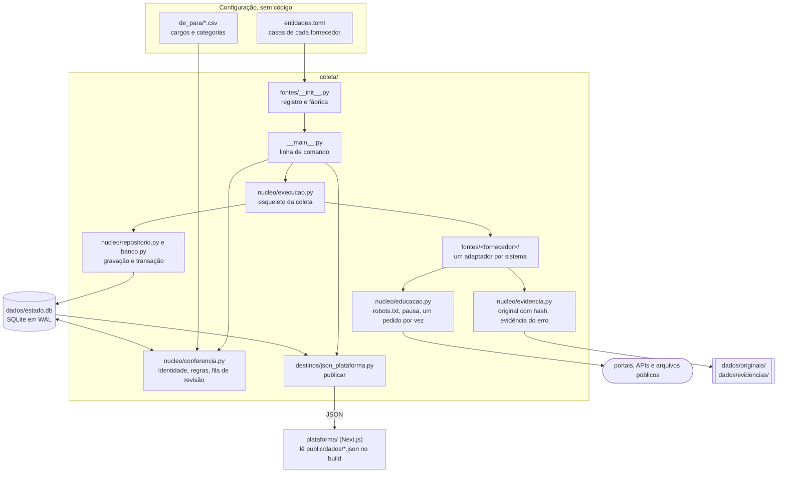
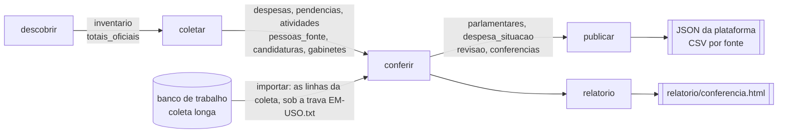
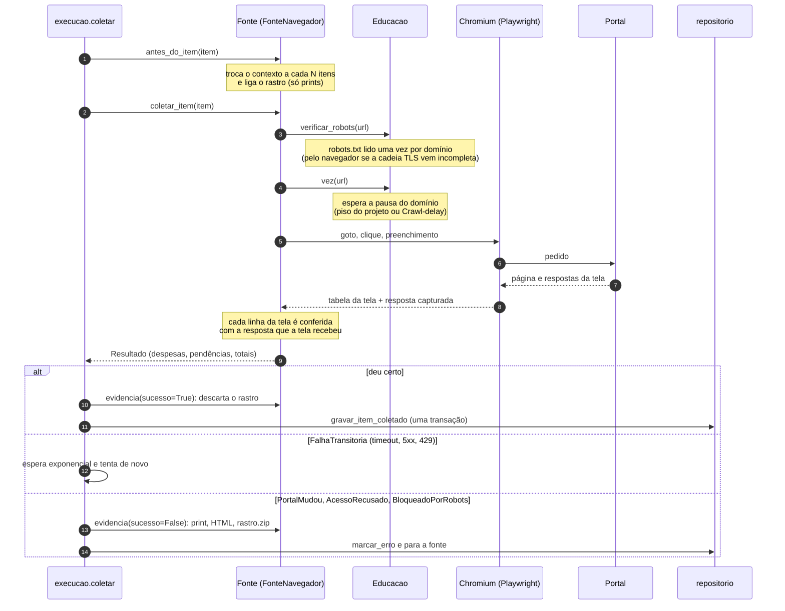
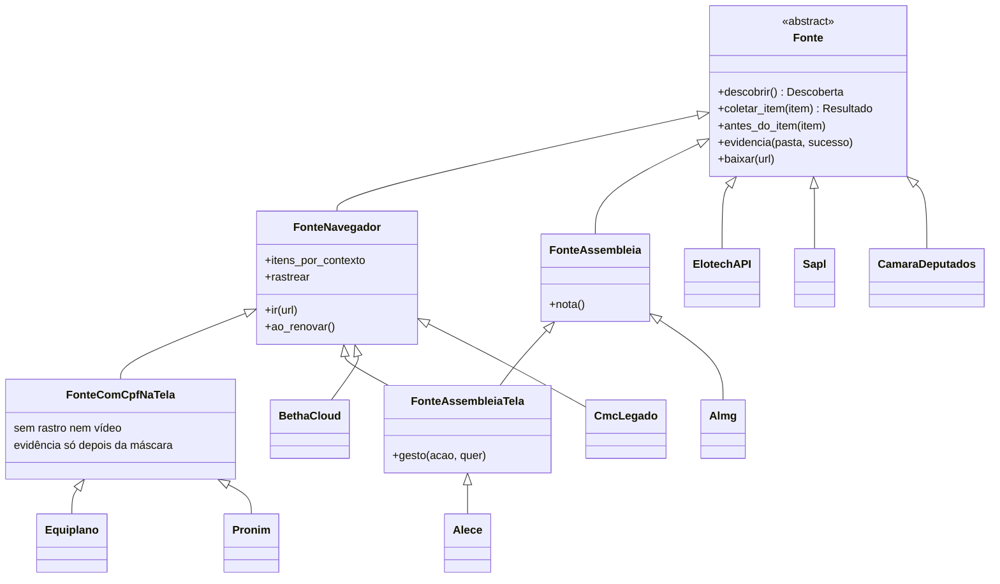

# Arquitetura

O projeto tem duas metades que só se falam por arquivo:

- **`coleta/`** (Python 3.11, Playwright, httpx, pydantic, SQLite): robôs que leem
  portais de transparência, um modelo único, a conferência e a publicação.
- **`plataforma/`** (Next.js, exportação estática): lê os JSON que o `publicar`
  grava em `plataforma/public/dados/` e gera o site. Em produção não há servidor
  nem banco: cada push na `main` vira um deploy de arquivos estáticos.

Este documento mostra como as peças se encaixam, os padrões que o código usa (e
onde) e as decisões que explicam o resto. O que cada portal exigiu está no
[README](../README.md); o levantamento das fontes, em [`etapa-0.md`](etapa-0.md); o
CI, em [`ci.md`](ci.md).

## Componentes

`dados/` fica fora do repositório: tem os originais como vieram (com nome de
servidor, quando a fonte publica), as evidências de erro e o banco. O que vai para
o repositório e para o site é só o que o `publicar` grava, depois das travas de
privacidade.

## Fluxo de dados

Cada etapa é um comando (`python -m coleta <etapa>`), roda sozinha e pode rodar de
novo. Elas conversam pelo banco: uma etapa lê as tabelas que a anterior gravou.

- **descobrir**: cada fonte lista o que há para coletar (o inventário: um item por
  ano, mês, deputado ou página) e anota o que a própria fonte diz de si: contador
  de registros, total do relatório, data de atualização.
- **coletar**: percorre o inventário. Um item gravado e o inventário marcado "ok"
  entram na mesma transação; a próxima rodada só pega o que está pendente ou com
  erro.
- **conferir**: numa transação só, apaga e refaz as tabelas derivadas. Liga as
  identidades (matrícula, nome civil, nome de urna do TSE), aplica as regras de cada
  fonte e confere o que foi lido contra os totais da fonte. O que não fecha vai para
  a fila de revisão, com o motivo; nada é completado nem arredondado.
- **publicar**: grava os JSON do site e um CSV por fonte, só com o que passou. Se
  algum texto ainda tiver CPF, para sem gravar o arquivo.
- **importar**: a coleta longa (horas no navegador) roda num banco de trabalho e
  entra no banco canônico numa transação, com os originais e as evidências.

## Uma coleta com Playwright

O caminho de um item numa fonte de navegador, do executor até o banco:

A fonte de navegador do Betha, por exemplo, abre o portal como uma pessoa, acha a
consulta de diárias pelo texto do item no menu (cada câmara monta o seu), lê a
tabela da tela página a página e confere cada linha com a resposta JSON que a
própria tela recebeu (`page.expect_response`). Se a tela e o dado não batem, é
`PortalMudou`: o robô para e guarda a evidência em vez de gravar o que não confere.

## Padrões de projeto

### Adapter e Strategy: uma fonte por sistema

[`fontes/base.py`](../coleta/fontes/base.py) define o contrato `Fonte`: `descobrir()`
e `coletar_item()`, mais ganchos opcionais. Cada fornecedor de portal é um
**adaptador** que traduz o formato dele (API Elotech, tela Vue do Betha, relatório
impresso do Equiplano, PDF do sistema legado) para o modelo único de
[`modelo.py`](../coleta/modelo.py): `Despesa`, `Pendencia`, `Atividade`,
`PessoaFonte`, `TotalOficial`. Para o executor, toda fonte é intercambiável
(**strategy**): ele não sabe de portal nenhum.

O diagrama mostra parte das classes; a lista inteira está em
[`fontes/__init__.py`](../coleta/fontes/__init__.py). O modo de cada uma (`api`,
`arquivo`, `robo`, `robo_pdf`) vai para o site, na ficha de cada sistema.

### Template Method: o esqueleto fixo de toda coleta

O algoritmo de coleta é um só e não muda de fonte para fonte:
[`nucleo/execucao.py`](../coleta/nucleo/execucao.py) percorre o inventário, confere o
disco, chama `antes_do_item`, `coletar_item` e `evidencia` e decide pelo tipo do
erro (repetir com espera, parar com evidência ou marcar e seguir). As subclasses
preenchem os passos: `FonteNavegador` usa `antes_do_item` para trocar o contexto do
navegador e ligar o rastro, e `evidencia` para guardar print, HTML e rastro no ponto
do erro; `FonteComCpfNaTela` troca a `evidencia` por uma que mascara a página antes
de gravar qualquer coisa e desliga rastro e vídeo.

O esqueleto mora no executor, e não num método da classe base, de propósito: o
executor também cuida do banco, da retomada e do placar, que não são assunto da
fonte. Dentro da fonte, `Fonte.baixar()` e `FonteNavegador.ir()` repetem a mesma
ideia em escala menor: todo pedido passa pelo robots.txt, espera a vez do domínio e
trata 5xx e 429 como falha transitória; o `baixar` ainda guarda o original com hash.

### Registro e fábrica: casa nova é configuração

[`entidades.toml`](../coleta/entidades.toml) lista, para cada fornecedor, as casas
que o adaptador atende (endereço, código da entidade, CNPJ ou IBGE conferido na
fonte, período). [`entidades.py`](../coleta/entidades.py) lê o arquivo em dataclasses
imutáveis, e `_construir()` em [`fontes/__init__.py`](../coleta/fontes/__init__.py)
cria uma instância de adaptador por entidade. O mesmo código do Elotech serve 12
câmaras além da de Curitiba; câmara nova num fornecedor que já tem adaptador é um
bloco no TOML, sem código. Uma casa que está no fornecedor mas não dá para coletar
fica no arquivo com `fora` e o motivo, que vai para a página Cobertura.

### Pipeline: etapas que se falam pelo banco

`descobrir → coletar → conferir → publicar` é um pipeline em que cada etapa lê o que
a anterior gravou (ver o fluxo acima). Isso deixa cada etapa rodar de novo sozinha:
corrigir uma regra da conferência não pede coletar de novo, e mudar o formato do
site não pede conferir de novo. A coleta é idempotente (refazer um item apaga o que
ele tinha gravado), e a conferência reconstrói as tabelas derivadas do zero, numa
transação.

### Camada de acesso ao SQLite

- [`nucleo/banco.py`](../coleta/nucleo/banco.py): o esquema, a migração aditiva de
  colunas, a conexão (WAL, autocommit, transação aberta à mão) e `transacao()`.
- [`nucleo/repositorio.py`](../coleta/nucleo/repositorio.py): tudo que a coleta
  grava: inventário, totais da fonte, resultado de cada item, histórico das rodadas.
  O executor decide; o repositório grava.
- Dinheiro é gravado como texto com o `Decimal` exato, nunca como `REAL`.

A conferência e o `publicar` fazem SQL direto, de leitura e agregação, porque é ali
que a consulta é a regra (o que soma, o que vai para revisão). Um repositório
genérico na frente deles só esconderia a regra.

### Dependências invertidas para testar sem rede

A fonte não cria os próprios clientes: recebe um `Contexto`
([`fontes/base.py`](../coleta/fontes/base.py)) com a conexão do banco, o navegador
já aberto e dois pontos de troca, `transporte_http` e `rotas_navegador`. Em
produção eles ficam vazios. Nos testes:

- **API falsa**: um `httpx.MockTransport` responde com amostras gravadas e injeta
  503 e timeout (Elotech, CLDF, ALMG, ALESP, SAPL).
- **Portal gravado**: uma rota do Playwright serve o portal legado de Curitiba a
  partir das amostras e injeta erro 500, lentidão e queda de sessão.
- **Portal falso local**: um servidor HTTP na máquina imita o formulário em cascata
  do Equiplano e o do Pronim, com CPF que fecha o dígito verificador, para provar
  que nada sai sem máscara.

`RPA_DADOS`, `RPA_PUBLICAR` e `RPA_RELATORIO` apontam cada teste para uma pasta
própria.

### Erros com tipo

[`nucleo/erros.py`](../coleta/nucleo/erros.py) tem quatro exceções, e cada uma leva a
uma decisão diferente no executor:

| Erro | Quando | O que o executor faz |
|---|---|---|
| `FalhaTransitoria` | timeout, 5xx, 429, tabela que não carregou | tenta de novo com espera exponencial |
| `PortalMudou` | seletor sumiu, coluna mudou, tela e resposta não batem | para a fonte e guarda a evidência |
| `BloqueadoPorRobots` | o robots.txt não permite o caminho | para a fonte |
| `AcessoRecusado` | captcha, login, bloqueio | para a fonte; nunca se contorna |

## Decisões de projeto

- **API ou arquivo quando existe; navegador só onde não há outro caminho.** O
  Elotech publica a API; a CEAP tem arquivo anual; Betha, Equiplano, Pronim, o
  portal da Prefeitura e as assembleias pela tela só se leem pelo navegador.
- **A tela é conferida contra o que ela mesma recebeu.** Nas fontes de navegador,
  o robô lê a tabela que a pessoa vê e a compara com a resposta que a página
  recebeu (ou com o rodapé do relatório, ou com a consulta do ano inteiro). A
  conferência não depende de confiar no seletor.
- **Origem = coletado + revisão.** Para cada fonte, as linhas que a fonte diz ter
  são as publicadas mais as que estão em revisão. O que não fecha não é chutado:
  fica na fila, com o motivo, e o site mostra que ficou de fora.
- **Privacidade na leitura, não na publicação.** Nome de servidor é descartado
  quando o cargo é lido, antes de gravar. Onde a tela mostra CPF inteiro, o robô
  lê o documento só na memória: no Pronim, mascara a página no próprio navegador
  antes de gravar qualquer coisa; no relatório do Equiplano, intercepta a resposta
  (`route.fetch`) e a limpa antes de o navegador recebê-la. O `publicar` ainda
  confere tudo de novo e recusa gravar com CPF.
- **Coleta educada.** robots.txt lido antes do primeiro pedido a cada domínio,
  Crawl-delay respeitado, um pedido por vez em cada portal, User-Agent que diz que é
  um robô. Cada fonte escolhe o seu User-Agent, porque o Betha devolve 403 para
  "HeadlessChrome" e o ASP.NET da Prefeitura só monta o postback para User-Agent de
  navegador. Captcha ou login tira a fonte do projeto.
- **Retomada por inventário.** Uma transação por item: a coleta pode cair a
  qualquer momento e a próxima rodada continua dali, sem duplicar nada.
- **Procedência de cada número.** Todo original é guardado com sha256; cada
  despesa leva a URL, o hash e o ponto do documento de onde saiu; o site mostra a
  ficha de procedência de cada valor.
- **Coleta longa num banco de trabalho.** Horas de navegador não seguram o banco
  canônico: a coleta roda à parte e o `importar` leva o resultado numa transação,
  sob a trava `dados/EM-USO.txt`.
- **Disco como limite de projeto.** O rastro do Playwright guarda só prints, o
  contexto é trocado a cada `RPA_ITENS_POR_CONTEXTO` itens, a fonte de item longo
  desliga o rastro, e a coleta para antes do próximo item com menos de
  `RPA_DISCO_MINIMO_MB` livres, deixando o resto pendente.
- **Saída determinística.** A mesma coleta publica o mesmo site byte a byte:
  ordens fixas, `SOURCE_DATE_EPOCH` para a data de geração, e um teste que roda a
  derivação com duas sementes de hash diferentes e compara a saída.
- **Site estático.** Sem servidor nem banco em produção. Os dados vão em JSON
  partidos: um arquivo por parlamentar com os agregados e as linhas à parte, um
  por parlamentar e ano, que a página só busca quando alguém abre aquele ano.

## Testes

| Tipo | Pasta | O que prova | Como roda |
|---|---|---|---|
| Unidade | [`coleta/testes/unidade/`](../coleta/testes/unidade/) | leitura de cada formato a partir de amostras reais gravadas (PDF, HTML, JSON, CSV, XLSX), regras da conferência, importar, determinismo; sem rede nem navegador | `python -m pytest` |
| Portal falso | [`coleta/testes/portal_falso/`](../coleta/testes/portal_falso/) | o robô inteiro contra uma API falsa, um portal gravado ou um portal falso local: falhas injetadas dão o mesmo resultado da rodada limpa, a retomada não duplica, CPF não sai sem máscara | `python -m pytest` |
| Contrato | [`coleta/testes/contrato/`](../coleta/testes/contrato/) | o portal de verdade ainda tem o formato que o robô espera; roda toda segunda-feira no CI e abre uma issue se algum mudou | `python -m pytest -m contrato` |

Os portais falsos, a gravação do portal legado e os geradores de amostra ficam em
[`coleta/testes/apoio/`](../coleta/testes/apoio/); as amostras, em
[`coleta/testes/amostras/`](../coleta/testes/amostras/).

A plataforma tem os seus: o teste de procedência (todo valor em reais na página tem
ficha), o axe em todas as telas, os prints de referência e o Lighthouse com
orçamento. Detalhe em [`ci.md`](ci.md).
